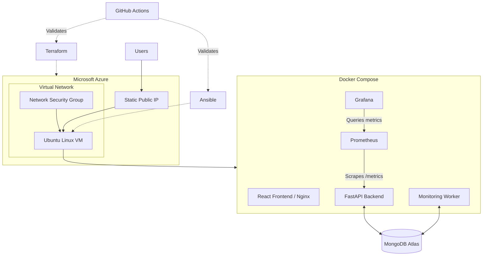

# APIWatch Infrastructure

**Infrastructure as Code for deploying and configuring APIWatch on Microsoft Azure.**

This repository contains the infrastructure provisioning, configuration management, security, and CI validation automation for [APIWatch](https://github.com/KHsalma123/apiwatch), an API uptime and performance monitoring platform.

The infrastructure is provisioned using **Terraform**, configured and deployed using **Ansible**, and runs the application using **Docker Compose**.

---

## Architecture



### Infrastructure Components

| Component | Description |
|---|---|
| Azure Resource Group | Groups project resources |
| Virtual Network | Provides network isolation |
| Subnet | Defines the VM network segment |
| Network Security Group | Controls inbound and outbound network traffic |
| Static Public IP | Provides external connectivity |
| Network Interface | Connects the VM to the virtual network |
| Linux Virtual Machine | Ubuntu Linux server hosting the application |
| Docker Engine | Runs application and monitoring containers |
| Docker Compose | Orchestrates application services |
| MongoDB Atlas | Managed database service |
| Prometheus | Collects backend metrics |
| Grafana | Visualizes metrics and manages alert rules |

## Technology Stack

| Category | Technologies |
|---|---|
| Cloud Provider | Microsoft Azure |
| Infrastructure as Code | Terraform |
| Configuration Management | Ansible |
| Containerization | Docker, Docker Compose |
| Operating System | Ubuntu Linux |
| Database | MongoDB Atlas |
| Monitoring | Prometheus, Grafana |
| CI | GitHub Actions |
| Version Control | Git, GitHub |
| Security | Azure NSG, SSH keys, Ansible Vault |

## Repository Structure

```text
apiwatch-infrastructure/
│
├── .github/
│   └── workflows/
│       └── ci.yml
│
├── main.tf
├── providers.tf
├── variables.tf
├── outputs.tf
├── .terraform.lock.hcl
├── .gitignore
├── README.md
│
└── ansible/
    ├── install-docker.yml
    ├── deploy-apiwatch.yml
    ├── inventory.ini.example
    └── files/
        └── apiwatch.env.example
```

The repository contains only the safe environment configuration example. The actual encrypted Ansible Vault file is kept locally and excluded from Git.

Local-only files such as `terraform.tfvars`, Terraform state files, execution plans, `ansible/inventory.ini`, the actual Vault file, and virtual environment files are excluded from Git.

### Terraform Files

| File | Purpose |
|---|---|
| `main.tf` | Defines Azure infrastructure resources |
| `providers.tf` | Configures Terraform and the Azure provider |
| `variables.tf` | Declares configurable infrastructure variables |
| `outputs.tf` | Exposes useful infrastructure information |
| `.terraform.lock.hcl` | Locks provider dependency versions |

### Ansible Files

| File | Purpose |
|---|---|
| `install-docker.yml` | Installs and configures Docker Engine and Docker Compose |
| `deploy-apiwatch.yml` | Deploys and configures APIWatch on the Azure VM |
| `inventory.ini.example` | Example Ansible inventory configuration |
| `files/apiwatch.env.example` | Safe example of application environment variables |

## Infrastructure Provisioning with Terraform

Terraform manages Azure resources through declarative Infrastructure as Code.

### 1. Prerequisites

Make sure you have:

- An active Azure subscription.
- [Terraform](https://developer.hashicorp.com/terraform/install).
- [Azure CLI](https://learn.microsoft.com/en-us/cli/azure/install-azure-cli).
- An SSH key pair.
- An authorized administrator public IP address.

### 2. Authenticate with Azure

```bash
az login
```

Check the active subscription:

```bash
az account show
```

### 3. Configure Variables

Create a local `terraform.tfvars` file:

```hcl
admin_ip = "YOUR_PUBLIC_IP"
```

This variable restricts SSH access to the authorized administrator IP address.

Do not commit `terraform.tfvars`.

### 4. Initialize Terraform

```bash
terraform init
```

### 5. Format and Validate

```bash
terraform fmt -recursive
terraform validate
```

### 6. Preview Infrastructure Changes

```bash
terraform plan
```

Review the proposed changes before proceeding.

### 7. Provision Infrastructure

```bash
terraform apply
```

Review the execution plan carefully and confirm only when you understand the resources that will be created, modified, or destroyed.

**Important:** Terraform apply can create billable Azure resources and modify existing infrastructure. It should be an intentional operation, not an automatic action on every Git push.

### 8. Retrieve Infrastructure Outputs

```bash
terraform output
```

Terraform outputs provide useful information such as the resource group name, VM name, public IP address, and SSH username.

## Server Configuration with Ansible

Ansible automates the installation and configuration of Docker on the Azure virtual machine.

### 1. Configure the Inventory

Create a local inventory using the example:

```bash
cp ansible/inventory.ini.example ansible/inventory.ini
```

Update it with the VM connection details:

```ini
[apiwatch]
YOUR_VM_PUBLIC_IP ansible_user=azureuser ansible_ssh_private_key_file=~/.ssh/id_ed25519
```

The inventory file is local and must not be committed.

### 2. Test SSH Connectivity

```bash
ansible -i ansible/inventory.ini apiwatch -m ping
```

### 3. Check Playbook Syntax

```bash
ansible-playbook -i ansible/inventory.ini ansible/install-docker.yml --syntax-check

ansible-playbook -i ansible/inventory.ini ansible/deploy-apiwatch.yml --syntax-check
```

### 4. Install Docker

```bash
ansible-playbook -i ansible/inventory.ini ansible/install-docker.yml
```

The playbook installs:

- Docker Engine.
- Docker CLI.
- containerd.
- Docker Buildx.
- Docker Compose plugin.

It also enables and starts the Docker service.

## Secure Application Deployment

The `deploy-apiwatch.yml` playbook automates APIWatch deployment on the Azure VM.

The deployment process includes:

1. Preparing the application deployment directory.
2. Using the existing Docker registry authentication configuration on the VM.
3. Deploying the encrypted environment configuration.
4. Pulling the required application images.
5. Starting the application services with Docker Compose.

The application repository must be available at `~/apiwatch` on the Ansible control machine because the deployment playbook uses it as the source of the Docker Compose and Prometheus configuration files.

The Azure VM must also have valid Docker registry authentication configured before the deployment playbook pulls the application images.

### Ansible Vault and Environment Configuration

The application environment file is protected using **Ansible Vault**.

The repository contains only:

```text
ansible/files/apiwatch.env.example
```

This example contains the same environment variable names as the application's `.env` file, but uses placeholder values. It is provided for documentation and configuration reference only.

The actual encrypted file:

```text
ansible/files/apiwatch.env.vault
```

must be created locally before deployment. It is excluded from Git through `.gitignore` and must never be committed.

To encrypt the application's environment file, run this command from the infrastructure repository root:

```bash
ansible-vault encrypt ~/apiwatch/.env --output ansible/files/apiwatch.env.vault
```

Ansible decrypts this local encrypted file during deployment. The plaintext environment file and the encrypted Vault file are not stored in the Git repository.

Run the deployment playbook using the Vault password prompt:

```bash
ansible-playbook -i ansible/inventory.ini ansible/deploy-apiwatch.yml --ask-vault-pass
```

The Vault password must remain private and must never be committed to Git.

## Application Deployment Architecture

The application configuration is maintained in the application repository.

[APIWatch Application Repository](https://github.com/KHsalma123/apiwatch)

The Azure Docker Compose deployment includes:

| Service | Purpose |
|---|---|
| Frontend | React application served by Nginx |
| Backend | FastAPI REST API |
| Worker | Scheduled API monitoring |
| Prometheus | Backend metrics collection |
| Grafana | Monitoring dashboards and alert rules |

MongoDB Atlas is used as the managed database.

Prometheus and Grafana are bound to localhost on the Azure VM to avoid exposing their management interfaces directly to the public internet.

## Monitoring and Observability

APIWatch uses Prometheus and Grafana for application observability.

### Prometheus

- Scrapes the FastAPI `/metrics` endpoint.
- Collects HTTP request metrics.
- Tracks request methods, routes, and response status codes.
- Uses a 15-second scrape interval.
- Retains monitoring data for 7 days.

### Grafana

An **APIWatch Monitoring Dashboard** provides:

- Backend Availability.
- HTTP Requests.
- HTTP Errors.

A Grafana alert rule monitors HTTP 5xx errors and can enter the firing state when the configured condition is met.

Grafana uses Prometheus as its data source.

## CI – GitHub Actions

GitHub Actions validates infrastructure code automatically on pushes to `main` and pull requests.

Workflow:

`.github/workflows/ci.yml`

### Terraform Validation Job

The workflow performs:

1. Repository checkout.
2. Terraform setup.
3. Terraform formatting validation.
4. Terraform initialization without configuring a remote backend.
5. Temporary SSH key generation for configuration validation.
6. Terraform validation.

### Ansible Validation Job

The workflow performs:

1. Repository checkout.
2. Python setup.
3. Ansible installation.
4. Syntax validation of `install-docker.yml`.
5. Syntax validation of `deploy-apiwatch.yml`.

The CI workflow validates configuration only. It does not provision, modify, or delete Azure resources.

No automatic Terraform apply is performed.

[View Infrastructure GitHub Actions](https://github.com/KHsalma123/apiwatch-infrastructure/actions)

## Security Considerations

Security is implemented throughout the infrastructure and deployment process.

### Azure Network Security

- SSH access is restricted to an authorized administrator IP through an NSG rule.
- SSH authentication uses public-key authentication.
- HTTP (port 80) and HTTPS (port 443) are allowed for application connectivity.
- Prometheus and Grafana management ports are bound to localhost.

### Secrets Management

- Ansible Vault encrypts sensitive deployment configuration.
- The actual encrypted Vault file and plaintext environment files are excluded through `.gitignore`.
- A safe environment configuration example is provided without real credentials.
- Private SSH keys are never stored in the repository.
- Registry authentication configuration remains on the VM.
- MongoDB Atlas credentials are provided through environment variables.

### Terraform Security

- Terraform state files are not committed.
- Terraform execution plans are not committed.
- Local variable files containing sensitive information are excluded.
- Terraform changes are reviewed before applying.

> Never commit credentials, private keys, plaintext environment files, the actual encrypted Vault file, Terraform state files, or Terraform execution plans.

## Cost Management

The project uses an Azure Virtual Machine to host the application and monitoring services.

To reduce unnecessary costs during periods of inactivity:

- Stop and deallocate the VM when it is not needed.
- Start it again when deployment or demonstrations are required.
- Monitor residual storage and networking charges in Azure Cost Management.

**Note:** Deallocating a VM stops its compute charges, but disks and certain networking resources may continue to incur costs.

## Key Learning Outcomes

Through this project, I gained practical experience in:

- Provisioning cloud infrastructure using Terraform.
- Managing Azure networking, virtual machines, and NSG rules.
- Implementing Infrastructure as Code practices.
- Automating server configuration and application deployment with Ansible.
- Securing sensitive deployment configuration with Ansible Vault.
- Containerizing and deploying applications with Docker Compose.
- Building infrastructure validation pipelines using GitHub Actions.
- Monitoring application metrics using Prometheus and Grafana.
- Managing cloud resources and controlling infrastructure costs.

## Related Repositories

- **Application:** [KHsalma123/apiwatch](https://github.com/KHsalma123/apiwatch)
- **Infrastructure:** [KHsalma123/apiwatch-infrastructure](https://github.com/KHsalma123/apiwatch-infrastructure)

---

**Project:** APIWatch  
**Cloud Platform:** Microsoft Azure  
**Focus:** Cloud Infrastructure | Terraform | Ansible | Docker | CI | Monitoring | DevOps
