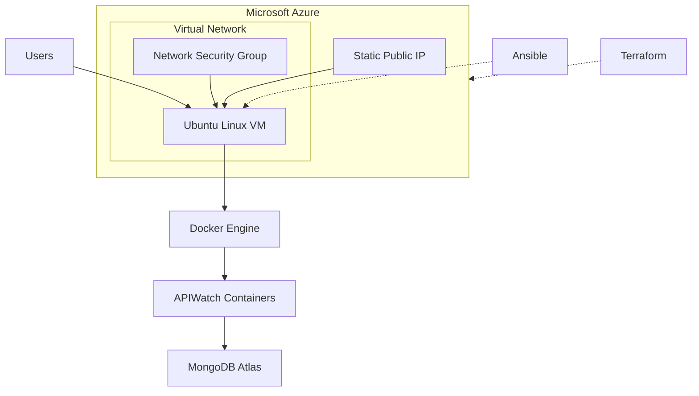

# APIWatch Infrastructure

**Infrastructure as Code (IaC) for deploying and configuring APIWatch on Microsoft Azure.**

This repository contains the infrastructure provisioning and configuration automation code for [APIWatch](https://github.com/KHsalma123/apiwatch), a web application for API monitoring.

The infrastructure is provisioned using **Terraform** and configured using **Ansible**, with Docker as the application runtime.

## Architecture



### Infrastructure Components

| Component | Description |
|---|---|
| Azure Resource Group | Groups all project resources |
| Virtual Network | Provides network isolation |
| Subnet | Defines the VM network segment |
| Network Security Group | Controls inbound network traffic |
| Public IP | Provides external connectivity |
| Network Interface | Connects the VM to the virtual network |
| Linux Virtual Machine | Ubuntu 24.04 LTS hosting the application |
| Docker Engine | Runs the application containers |
| MongoDB Atlas | Managed database service |

## Technology Stack

- **Cloud Provider:** Microsoft Azure
- **Infrastructure as Code:** Terraform
- **Configuration Management:** Ansible
- **Containerization:** Docker, Docker Compose
- **Operating System:** Ubuntu 24.04 LTS
- **Database:** MongoDB Atlas
- **Version Control:** Git & GitHub

## Repository Structure

```text
apiwatch-infrastructure/
│
├── main.tf
├── providers.tf
├── variables.tf
├── outputs.tf
├── .terraform.lock.hcl
├── .gitignore
├── README.md
│
└── ansible/
    ├── install-docker.yml
    ├── inventory.ini.example
    └── inventory.ini
```

**Terraform files:**
- `main.tf`: Defines Azure infrastructure resources.
- `providers.tf`: Configures Terraform and the Azure provider.
- `variables.tf`: Declares configurable infrastructure variables.
- `outputs.tf`: Exposes useful infrastructure information.
- `.terraform.lock.hcl`: Locks provider dependency versions.

**Ansible files:**
- `install-docker.yml`: Installs Docker Engine and Docker Compose on the Azure VM.
- `inventory.ini.example`: Example Ansible inventory configuration.
- `inventory.ini`: Local inventory file (not committed).

## Infrastructure Provisioning with Terraform

Terraform manages the Azure infrastructure through declarative configuration.

### 1. Prerequisites

Make sure you have:

- An Azure subscription.
- [Terraform](https://developer.hashicorp.com/terraform/install) installed.
- [Azure CLI](https://learn.microsoft.com/en-us/cli/azure/install-azure-cli) installed.
- An SSH key pair.

### 2. Authenticate with Azure

```bash
az login
```

### 3. Configure Variables

Create a local `terraform.tfvars` file:

```hcl
admin_ip = "YOUR_PUBLIC_IP"
```

This variable restricts SSH access to the authorized administrator IP address.

Do not commit this file.

### 4. Initialize Terraform

```bash
terraform init
```

### 5. Validate Configuration

```bash
terraform fmt -recursive
terraform validate
```

### 6. Preview Infrastructure Changes

```bash
terraform plan
```

### 7. Provision Infrastructure

```bash
terraform apply
```

Review the execution plan before confirming.

### 8. Retrieve Infrastructure Outputs

```bash
terraform output
```

Terraform outputs provide useful information such as the resource group name, VM name, public IP address and SSH username.

## Server Configuration with Ansible

Ansible automates the installation and configuration of Docker on the Azure virtual machine.

### 1. Configure the Inventory

Create your local inventory from the provided example:

```bash
cp ansible/inventory.ini.example ansible/inventory.ini
```

Update it with your VM connection details:

```ini
[apiwatch]
YOUR_VM_PUBLIC_IP ansible_user=azureuser ansible_ssh_private_key_file=~/.ssh/id_ed25519
```

### 2. Test SSH Connectivity

```bash
ansible -i ansible/inventory.ini apiwatch -m ping
```

### 3. Check Playbook Syntax

```bash
ansible-playbook -i ansible/inventory.ini ansible/install-docker.yml --syntax-check
```

### 4. Install Docker

```bash
ansible-playbook -i ansible/inventory.ini ansible/install-docker.yml
```

The playbook installs:

- Docker Engine
- Docker CLI
- containerd
- Docker Buildx
- Docker Compose plugin

It also enables and starts the Docker service.

## Application Deployment

Once the infrastructure is provisioned and Docker is installed, the Azure-specific application configuration is available in the application repository.

**Application repository:** [APIWatch](https://github.com/KHsalma123/apiwatch)

The application uses Docker Compose to run its services and MongoDB Atlas as its managed database.

## Security Considerations

Security is considered throughout the infrastructure configuration:

- SSH access is restricted to a specific administrator IP using an NSG rule.
- SSH authentication uses public-key authentication.
- HTTP (80) and HTTPS (443) are allowed for application connectivity.
- Sensitive configuration files are excluded through `.gitignore`.
- Terraform state files and execution plans are not committed.
- Private SSH keys and environment files are never stored in the repository.
- MongoDB Atlas credentials are provided through environment variables.

**Never commit credentials, private keys, Terraform state files, or `.env` files.**

## Key Learning Outcomes

Through this project, I gained practical experience in:

- Provisioning cloud infrastructure using Terraform.
- Managing Azure networking and virtual machines.
- Implementing Infrastructure as Code (IaC) practices.
- Automating server configuration with Ansible.
- Installing and configuring Docker on cloud infrastructure.
- Managing SSH access and network security rules.
- Separating application code from infrastructure configuration.

## Related Repository

- **Application:** [KHsalma123/apiwatch](https://github.com/KHsalma123/apiwatch)
- **Infrastructure:** [KHsalma123/apiwatch-infrastructure](https://github.com/KHsalma123/apiwatch-infrastructure)

---

**Project:** APIWatch  
**Cloud Platform:** Microsoft Azure  
**Focus:** Cloud Infrastructure | Terraform | Ansible | DevOps
